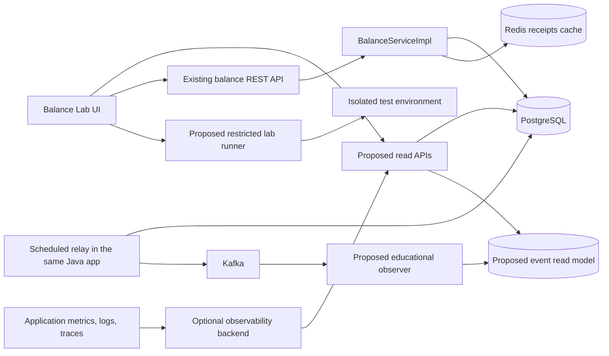

# Balance Lab: Educational UI and Observability Plan

**Status: NOT IMPLEMENTED**  
**Prepared: 2026-11-14**  
**Purpose: Future implementation handoff for an educational project**

This document records the proposed Balance Lab interface and its supporting APIs,
observability, and test infrastructure. Creating this document does not implement
or enable any feature. All implementation checkboxes below are intentionally
unchecked. No application services or application tests were run to prepare this
handoff. The earlier interactive design used fictional data and local interactions;
its displayed health, throughput, latency, balances, and results are not measurements.

This document is self-contained. Implementation must not depend on a previous chat,
a session-local preview file, or the original mockup's code. Start implementation
when requested, and inspect the repository again before applying this plan.

## 1. Objective and scope

Build an attractive, understandable educational interface that lets a learner:

- Inspect accounts, current balances, successful operations, and request attempts.
- Follow a transfer through validation, locks, idempotency, database commit, and
  asynchronous Kafka delivery.
- Explore logical components and physical deployment dependencies.
- Relate API behavior to metrics, structured logs, traces, and persisted evidence.
- Try API operations and run repeatable correctness, concurrency, and failure scenarios.
- Understand what the system has proved, what it has observed, and what is unknown.

Preserve existing balance-operation semantics, atomicity, locking, idempotency,
and outbox guarantees. UI telemetry must not become a new financial authority.
Do not split the application into microservices merely to draw a service map.
Production hosting, Kubernetes, a general SQL console, arbitrary command execution,
and a production operations platform are outside this plan.

## 2. Repository baseline and mandatory revalidation

The working tree already contained unrelated, uncommitted changes when this plan
was saved. Leave those changes intact. The source may continue evolving; the
following is an inspected snapshot, not a substitute for reading current code.

| Area | Inspected state | Relevant source |
| --- | --- | --- |
| Runtime | Java 21, Spring Boot 3.5.x; one application | `pom.xml`, `compose.yml` |
| REST | Create account, read one balance, credit, debit, transfer | `src/main/java/com/challenge/balance/web/BalanceController.java` |
| Persistence | PostgreSQL; accounts, successful receipts, pending outbox, relay lock | `src/main/resources/db/migration/V1__initial_schema.sql` |
| Operations | Ordered JVM stripes and DB row locks; transaction boundaries | `src/main/java/com/challenge/balance/service/BalanceServiceImpl.java`, `src/main/java/com/challenge/balance/concurrency/AccountLockManager.java` |
| Idempotency | Redis cache backed by durable JDBC receipts | `src/main/java/com/challenge/balance/idempotency/` |
| Events | Transactional outbox and scheduled Kafka publisher | `src/main/java/com/challenge/balance/events/` |
| Health | Only health is exposed; readiness includes `readinessState,db` | `src/main/resources/application.yml` |
| Outbox metrics | `balance.kafka.outbox.pending`, `.published`, `.failures` | `src/main/java/com/challenge/balance/events/KafkaOutboxPublisher.java` |
| API documentation | springdoc/Swagger UI dependency exists | `pom.xml`, `README.md` |
| Tests | Unit, PostgreSQL/Testcontainers, embedded Kafka, simulated/live Redis | `src/test/java/com/challenge/balance/` |

**Money contract correction:** The first design discussion inspected integer
`long`/`BIGINT` amounts. At save time, the working source uses `BigDecimal` and
PostgreSQL `NUMERIC` for balances and amounts. Do not implement the earlier
integer-only input restriction or a signed-64-bit money limit. Revalidate the
DTOs, serialization, validation, tests, database migrations, Redis receipt JSON,
and Kafka schema together before settling the frontend contract. This plan does
not claim that the in-progress decimal conversion is complete or tested.

Do not assume a currency, a two-decimal scale, cents, rial, or toman. Agree on an
explicit unit/scale policy if the business contract does not define one. Preserve
numeric idempotency equality: equivalent decimal values such as `20` and `20.00`
must follow the current domain's comparison semantics.

## 3. Facts the UI must represent correctly

### 3.1 Financial state, HTTP attempts, and delivery are distinct

- `processed_transactions` contains successful operation receipts. It is not an
  HTTP request log, failure history, or a complete double-entry ledger.
- A retry can be successful without creating a second receipt or mutation.
- An identical successful retry returns the current balance, not a replay of the
  original HTTP response. The controller reads balance again after the operation;
  concurrent activity may therefore affect the returned value.
- Failed operations are retryable with the same transaction ID when appropriate.
  A failed attempt must not permanently mark that ID as consumed.
- Client timeout does not prove rollback. Show an unknown result until a receipt
  lookup or other reliable evidence resolves it.
- A transfer commits both balances, its receipt, and its outbox rows atomically
  when event recording is enabled. Kafka delivery occurs separately.
- Transfer creates two distinct logical events, one per account, correlated by
  transaction ID. Credit and debit create one. Account creation currently does
  not participate in this event contract.
- Kafka delivery is at least once. Deduplicate logical events by `eventId`;
  preserve repeated deliveries separately if displaying retry evidence.
- Two transfer events may be observed at different times across partitions.
  Do not claim an atomic Kafka transfer view or a global order across partitions.

### 3.2 Visibility limits

- The publisher deletes acknowledged outbox rows after its database commit.
  Outbox is a pending queue, not a delivery archive.
- An absent row is not proof that a particular event was delivered. Recording may
  have been disabled, historical data may predate events, or observation may be missing.
- Existing data cannot reconstruct complete historical balances: initial funding
  and account creation are not covered by the current balance-change event stream.
  Introduce a baseline/snapshot policy before offering historical charts.
- `processedAt` is constructed before transaction completion; it is not an exact
  commit timestamp or a substitute for measured spans. Label timestamps honestly.
- Readiness can be healthy while Redis is in fallback or Kafka delivery is impaired.
  Display component health and delivery health independently.
- Distinguish Kafka recording disabled, publishing paused, broker unavailable,
  observer unavailable, stale evidence, and unknown state.
- A failure at the head of the sequential relay prevents later sends. Show the
  oldest pending age and the blocked head, not just queue count.

### 3.3 Precision and consistency

- Keep money exact end to end. Do not use JavaScript `Number`, `parseFloat`, or
  floating-point arithmetic for balances, amounts, or conservation assertions.
- Prefer decimal strings in new read-model DTOs, with a documented decimal parser
  and arithmetic implementation. Existing business JSON may encode decimal numbers;
  use lossless parsing/serialization at that boundary. Converting a value to a
  string after ordinary JSON parsing does not restore lost precision.
- Keep large sequence IDs and offsets as strings where necessary as well.
- Preserve existing business wire contracts unless a separately reviewed change
  explicitly introduces a compatible transition.
- A total-balance invariant requires a consistent database snapshot of the account
  set and a controlled workload. Transfer-only workloads conserve the total;
  credits, debits, and account creation can change it legitimately.

## 4. Product design

### 4.1 Shared shell and interaction rules

- Product name: **Balance Lab**. Desktop-first, responsive down to 320 CSS pixels.
- Primary interface: Persian/RTL. Technical IDs, URLs, SQL, JSON, and code remain
  LTR in isolated regions. Keep labels ready for future English localization.
- Use a right-side desktop navigation, collapsing into wrapping navigation on
  small screens. Avoid a fixed-height, internally scrolling application shell.
- Use restrained light/dark surfaces, readable Persian typography, compact data
  tables, and a single accent. Pair status colors with words/icons.
- Show the selected environment, data source, time range, freshness, and demo/live
  mode. Never silently substitute simulated values when live sources fail.
- Use one selected-record detail panel instead of permanent walls of cards.
- Allow educational explanations and display density to be toggled.
- Provide keyboard operation, visible focus, labeled controls, loading/empty/error
  states, and text equivalents for diagrams. No essential hover-only information.
- Persist timestamps in UTC and explicitly label the display timezone. Do not
  mix browser time, server time, and event time without explanation.

### 4.2 Six application sections

| Section | Primary content | Main interaction |
| --- | --- | --- |
| Overview | Independently labeled API/DB/cache/delivery states, a few meaningful metrics, recent receipts | Select a receipt and follow its evidence |
| Accounts and transfers | Paginated accounts, exact balances, operation history, API playground | Select an account; draft, inspect, and submit an operation |
| Request path | Validation, JVM locks, DB locks, idempotency, mutation, commit; separate relay path | Correlate requests, receipts, events, logs, and traces |
| Structure and relationships | Logical component map and physical deployment map | Select a component to see responsibility, dependencies, evidence, and source links |
| Technical monitoring | Time-series metrics, relevant logs, traces, queue health | Select a window/instance and drill into related evidence |
| Test lab | Named scenarios, inputs, expectations, run progress, assertions, reports | Start an isolated run, inspect results, stop further workload scheduling |

Overview example for a controlled demo: A starts at 1,000 and B at 100. A transfer
of 20 commits A=980 and B=120 while Kafka is unavailable. Show financial state as
committed and delivery as pending, with two expected logical events. All such
fixtures must be clearly labeled as examples, not benchmark or production data.

### 4.3 Explorer details

The explorer should connect `transactionId` (business operation), `requestId`
(one HTTP attempt), `traceId` (execution), `eventId` (logical event), and `runId`
(test run). Transaction ID alone cannot distinguish retries.

Render the actual synchronous order:

1. Validate request fields and path IDs.
2. Acquire JVM stripes in stripe-index order.
3. Begin the database transaction and lock account rows in account-ID order.
4. Check Redis/JDBC for a completed transaction ID.
5. For a new operation, check funds and write balances, receipt, and optional outbox.
6. Commit; cache receipts after commit; release JVM locks.
7. Read the current balance for the response and complete HTTP handling.

Show duplicate and conflicting-ID branches without drawing a second mutation.
Render the scheduled relay as a separate asynchronous execution: relay lock,
read pending event, Kafka send/ACK, outbox deletion, relay transaction commit.
Instrumentation must not change this ordering.

A static walkthrough is useful before tracing exists, but label it conceptual.
Measured waterfalls require real spans, including separate JVM-lock wait and
database-lock/query timing. Do not animate fake durations as live tracing or
pause a real database transaction to support an educational step-through.

## 5. Proposed implementation architecture

Use a React + TypeScript frontend and additive Java read/lab modules. Prefer
same-origin routing through a development proxy and, later, static serving or a
reverse proxy. Keep frontend access behind HTTP APIs; do not expose database,
Redis, Kafka, Docker credentials, or infrastructure control to browser code.

React Flow is a candidate for interactive component maps. Choose chart/table
libraries only after checking accessibility, decimal handling, RTL support,
compatibility, and maintenance. Pin selected dependency versions and lockfiles
during implementation; this plan does not mandate unverified versions.

Proposed source locations, subject to repository conventions:

- `frontend/`: shell, screens, API adapters, exact decimal utilities, UI tests.
- `src/main/java/com/challenge/balance/observability/`: bounded telemetry hooks.
- `src/main/java/com/challenge/balance/lab/`: read APIs and local lab configuration.
- `src/main/resources/db/migration/`: new versioned migrations if required.
- `docs/`: API decisions, scenario descriptions, and local setup instructions.

Use an opt-in lab profile/feature flag for lab controls. Use a separate restricted
runner process/container when tests need process or infrastructure control. A
read-only report viewer can precede automated execution. Keep observability
services optional so the normal balance service can still run independently.

### 5.1 Data flow



The Java service, lock manager, and relay are logical components, not independent
deployments. A map may be curated from source initially; label topology as configured
and health overlays as observed. Do not imply automatic runtime discovery exists.

### 5.2 Proposed API contracts

All routes below are **new proposals**, not existing endpoints. First document
them in OpenAPI and add typed DTOs. Preserve existing `/accounts` operations.

| Proposed route | Responsibility and source |
| --- | --- |
| `GET /admin/accounts` | Bounded account list from PostgreSQL; account-ID filtering and cursor pagination |
| `GET /admin/transactions` | Successful receipts; filter by account, type, transaction ID, time |
| `GET /admin/transactions/{transactionId}` | One receipt and linked evidence; lookup must handle IDs that need URL encoding |
| `GET /admin/requests` | Attempt log/read model; distinguish business rejection, retry, technical failure, unknown client result |
| `GET /admin/outbox` | Pending rows and bounded aggregate queue information |
| `GET /admin/events` | Persisted logical events and delivery observations from the proposed observer |
| `GET /admin/telemetry` | Bounded summary/query adapter for UI panels; never an arbitrary query proxy |
| `POST /lab/runs` | Accept a named allowlisted scenario and validated parameters; return `202` and a run ID |
| `GET /lab/runs/{runId}` | Run state, environment, inputs, assertion results, artifacts, timestamps |
| `POST /lab/runs/{runId}/cancel` | Stop scheduling new work; do not imply committed operations can be undone |
| `GET /lab/runs/{runId}/stream` | Optional SSE progress, with reconnect/resume behavior |

List DTOs should use an envelope such as `items`, `nextCursor`, `observedAt`,
`source`, and `stale`. Use stable ordering and opaque cursors; cap limits and time
ranges, use parameterized queries, and add justified indexes with migrations.
Do not promise that separate pages form one historical snapshot during mutations.
Use an explicit snapshot operation when conservation evidence requires one.

New monetary DTO fields should use decimal strings. Example account:

```json
{"accountId":"A","balance":"980.00"}
```

Use the existing Problem Detail error format, including `error` and `fieldErrors`,
and render errors next to fields as well as in a request/response inspector.
Validate against the current account-ID and transaction-ID contracts. Do not
automatically reuse a transaction ID when editing a previously submitted payload.
Offer explicit same-payload retry and deliberate conflict demonstrations.

### 5.3 New read models and evidence

- Successful operation queries can read existing receipts. Do not add UI bookkeeping
  to the financial transaction unless required for a documented correctness reason.
- Persist request attempts separately when history is needed. Distributed traces
  may be sampled or expire and cannot substitute for a complete attempt audit.
- Introduce a logical event read model keyed by `eventId`, with separate delivery
  observations containing topic, partition, offset, and observation time. Insert
  deduplicated state before committing observer offsets; make restart replay safe.
- Correlate both transfer events by transaction ID and account roles. A partial
  observation remains partial; duplicate transport delivery is not a new transfer.
- Run the observer under a dedicated consumer group. Its lag measures that observer,
  not an absent business consumer or guaranteed end-to-end business processing.
- Define start-offset/backfill, retention, source timestamps, and baseline behavior.
  Existing historical gaps must remain visible rather than being filled with guesses.
- Add schema changes using new Flyway versions. Do not edit applied migrations;
  inspect migration history first, especially while the decimal conversion evolves.

## 6. Observability design

Start with Actuator/Micrometer and Prometheus/Grafana. Add the registry dependency
and narrowly configured endpoint exposure; Actuator alone does not expose the
Prometheus output. Configure appropriate HTTP histograms for p95/p99 reporting.
Add Micrometer Tracing/OpenTelemetry and structured log collection in a later
phase. Optional Grafana LGTM is suitable for local teaching/demo use; avoid
deploying duplicate metrics backends without an intentional design.

| Layer | Required observations |
| --- | --- |
| HTTP | Request rate, p50/p95/p99 duration, status/outcome by route template |
| Business | Applied operations, duplicate suppression, conflicts, insufficient funds, technical errors |
| JVM/process | Heap, GC, threads, CPU; label process vs host measurements |
| JDBC/Hikari | Active/idle/max connections, pending acquisitions, acquisition time |
| Concurrency | JVM stripe wait/hold timing separately from DB row/query wait evidence |
| PostgreSQL | Connection/lock pressure and query latency through bounded monitoring access |
| Redis | Cache hit/miss, invalid receipt, fallback, backoff, write-after-commit failure |
| Outbox | Existing pending/published/failures; oldest pending age and delivery duration to add |
| Kafka observer | Observation latency, observer lag, duplicate deliveries, partial transfer pairs |

Treat expected 4xx business rejections separately from unexpected technical failure.
Place transaction, account, request, event, and run IDs in logs/traces/evidence,
not unbounded metric labels. Use bounded labels such as operation, route template,
outcome, and instance. Persist trace context or use explicit span links through
the asynchronous outbox boundary; propagation is not automatic with the current
payload. Review event-version compatibility before changing that contract.

`outbox.pending` describes a shared database queue: do not sum identical gauges
across application replicas. Published/failure counters are per-process attempts,
can reset on restart, and are not a durable unique-event delivery ledger. Choose
bounded scrape/query intervals and inspect the cost of queue counts as data grows.
Monitoring queries should not acquire account mutation locks.

Show freshness and unavailable states on every live panel. Thresholds must be
configurable and based on measured baselines; fictional mockup values are not SLOs.

## 7. Test lab and verification

### 7.1 Execution model

Reuse current unit/integration tests as correctness evidence; do not translate
their logic into browser simulations and call that verification. Add HTTP-level
scenarios for exercising a running isolated stack. Present fixture, scenario,
expected behavior, actual observations, assertions, and linked logs separately.

Each run records its ID, code revision/dirty-state description, scenario version,
seed, environment, parameters, dependency modes, timestamps, limits, and reports.
Use bounded run concurrency, duration, request volume, progress, and cancellation.
Cancellation stops new requests; in-flight work may finish and committed data stays
committed. Distinguish queued/running/passed/failed/cancelled/infrastructure-error.

Use isolated Testcontainers or an explicitly separate disposable lab stack and
database. Never apply existing test cleanup SQL to the normal development database.
Infrastructure fault controls must target only the run-owned environment. Do not
mount Docker control into the browser-facing application or accept arbitrary shell,
Maven arguments, URLs, SQL, or filesystem paths from the UI.

### 7.2 Initial scenario catalog

| Scenario | Required assertion | Existing starting point |
| --- | --- | --- |
| Credit/debit/transfer | Exact arithmetic, validation, expected Problem Detail errors | `service/CreditOperationTest`, `DebitOperationTest`, `TransferOperationTest`, `ApiValidationIntegrationTest` |
| Concurrent double spend | From 100, two distinct withdrawals of 80 produce one success, one rejection, final 20 | `SingleAccountConcurrencyTest`, `BalanceServiceIntegrationTest` |
| Identical duplicate transfer | One mutation and receipt; two logical events if recording is enabled | `IdempotencyTest`, `KafkaOutboxIntegrationTest` |
| Conflicting transaction ID | Changed payload is rejected; winning operation remains authoritative | `IdempotencyTest`, `RedisIdempotencyIntegrationTest` |
| Opposite-direction transfers | Completion within test deadline and preserved total under transfer-only load | `MultiAccountConcurrencyTest`, `BalanceServiceIntegrationTest` |
| Independent/colliding accounts | Correct state despite stripe collisions; no false claim of unlimited parallelism | `AccountLockManagerTest`, `MultiAccountConcurrencyTest` |
| Redis unavailable | JDBC fallback preserves operation correctness and duplicate protection | `RedisIdempotencyIntegrationTest` |
| Kafka unavailable/recovered | Financial commit remains independent; pending events survive and eventually deliver | `KafkaOutboxIntegrationTest` |
| ACK followed by DB failure | Redelivery retains event ID; observer does not count a new logical event | `KafkaOutboxIntegrationTest` |
| Outbox write failure | Balances, receipt, and newly inserted events roll back together | `PostgresPersistenceIntegrationTest`, `KafkaOutboxIntegrationTest` |
| Decimal precision and retries | Fractional/large values survive UI, API, DB, cache, event, and retry round trips exactly | Revalidate and extend tests after current money-contract changes settle |

Database integration tests require Docker and disposable PostgreSQL containers;
Kafka integration tests use an embedded broker. The live Redis test is opt-in via
`RUN_REDIS_TESTS=true`; read its prerequisites before scheduling it. Skipped tests
must appear as skipped, and missing infrastructure must not appear as a pass.

Add k6 load testing separately from deterministic correctness tests. Define explicit
checks and pass/fail thresholds; expected rejection scenarios need scenario-specific
HTTP expectations. Report offered load, achieved throughput, latency distribution,
failures, workload mix, hardware, and dependency configuration. UI rendering and
telemetry overhead must not be misreported as service performance improvements.

## 8. Incremental implementation checklist

All items are pending. Implement and verify one coherent phase at a time.

### Phase 0: Reconcile the current contract

- [ ] Inspect applicable repository instructions and current worktree changes.
- [ ] Verify decimal types, unit/scale policy, wire formats, cache/event compatibility,
      migrations, and tests; record decisions without reverting unrelated work.
- [ ] Inventory current endpoints, OpenAPI, health, metrics, and Docker prerequisites.
- [ ] Establish the actual test baseline; report existing failures separately.
- [ ] Choose supported frontend dependencies and document lab-environment boundaries.

### Phase 1: Accounts, receipts, and manual API exploration

- [ ] Add the responsive RTL shell and clearly separated demo/live modes.
- [ ] Add bounded account/receipt read APIs, exact decimal adapters, and typed clients.
- [ ] Implement account selection, successful-operation history, and request/response
      inspection using existing business APIs.
- [ ] Add explicit retry/conflict UX and a conceptual, clearly labeled request path.
- [ ] Add focused API and UI checks for paging, validation, precision, errors, and accessibility.

**Exit condition:** A learner can inspect actual accounts/receipts and exercise
operations with truthful outcomes. Screens needing unavailable evidence say so.

### Phase 2: Metrics and asynchronous event evidence

- [ ] Add optional metrics export/backend configuration and focused dashboards.
- [ ] Instrument missing business/cache/lock/queue measurements without changing semantics.
- [ ] Add the dedicated Kafka observer and durable deduplicated event read model.
- [ ] Implement pending/delivery/unknown/disabled states, freshness, and component maps.
- [ ] Verify outage/recovery, duplicate event delivery, partial transfer observation,
      observer restart, and multiple app instances.

**Exit condition:** A learner can distinguish financial commit from event delivery
and can investigate backlog using actual observations.

### Phase 3: Trace correlation and reproducible lab runs

- [ ] Add structured logs, real spans, and explicit correlation across async boundaries.
- [ ] Add the restricted isolated runner, run APIs, report storage, and progress UI.
- [ ] Expose the initial correctness/concurrency/failure catalog with real assertions.
- [ ] Add cancellable workload scheduling and truthful infrastructure/skipped states.
- [ ] Add separately configured k6 scenarios and measured performance thresholds.

**Exit condition:** Every displayed pass/fail refers to a real run and inspectable
evidence. A conceptual walkthrough is never presented as an actual trace.

### Phase 4: Polish and handoff

- [ ] Verify all six sections at narrow/mobile and desktop widths, in both themes.
- [ ] Verify keyboard access, RTL/LTR mixing, field errors, and empty/stale/offline states.
- [ ] Document startup profiles, ports, data retention, reset boundaries, and limitations.
- [ ] Run applicable existing tests plus focused new tests, review the diff, and report
      remaining gaps. Update this document's status only for work actually completed.

## 9. Acceptance criteria for the completed feature

- No existing financial/idempotency/outbox guarantee regresses.
- Monetary values remain exact through all displayed and submitted representations.
- UI evidence distinguishes request attempts, successful receipts, and event deliveries.
- Missing, sampled, stale, disabled, or partial evidence is visible and never fabricated.
- Financial success can coexist with impaired Kafka delivery without contradictory labels.
- Maps distinguish in-process modules from independently deployed infrastructure.
- Test runs are isolated, bounded, reproducible, and backed by actual reports/assertions.
- Enabling UI/telemetry does not require changing the normal application's data or
  running destructive cleanup; optional lab dependencies remain opt-in.
- Setup and contract decisions are documented in the repository so another agent
  can continue without previous chat context.

## 10. Reference documentation

Verify version compatibility again during implementation.

- [Spring Boot 3.5 metrics](https://docs.spring.io/spring-boot/3.5/reference/actuator/metrics.html)
- [Spring Boot 3.5 tracing](https://docs.spring.io/spring-boot/3.5/reference/actuator/tracing.html)
- [React Flow documentation](https://reactflow.dev/learn)
- [Grafana Docker OpenTelemetry LGTM](https://grafana.com/docs/opentelemetry/docker-lgtm/)
- [k6 scenarios](https://grafana.com/docs/k6/latest/using-k6/scenarios/)
- [k6 thresholds](https://grafana.com/docs/k6/latest/using-k6/thresholds/)
